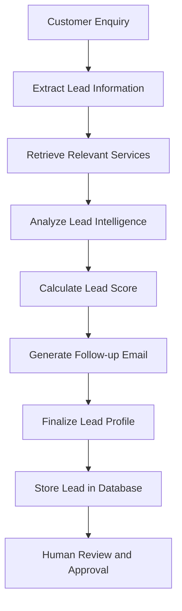
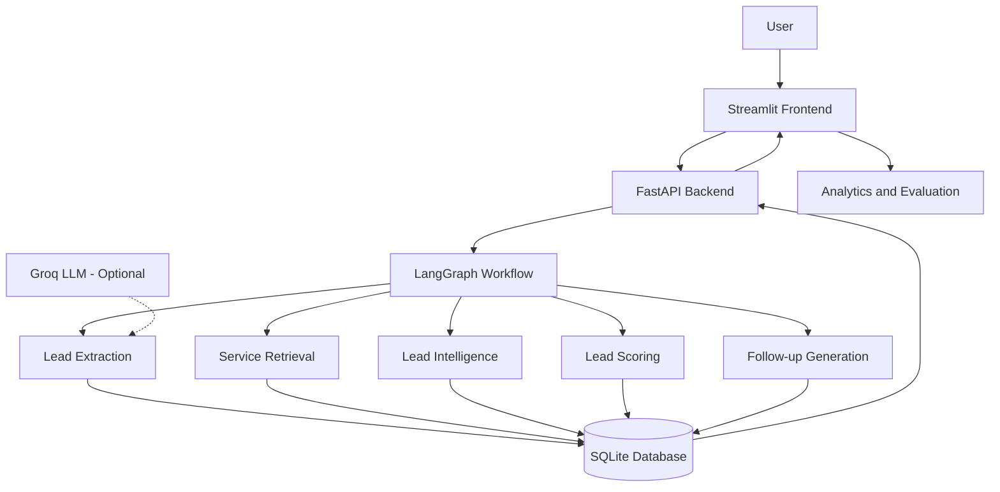

# 🚀 Cynbit LeadPilot AI

### AI-Powered Lead Intelligence, Qualification & Conversion Management

<p align="center">
  <strong>Transform customer enquiries into actionable sales intelligence.</strong>
</p>

<p align="center">
  
  
  
  
  
  
</p>

---

## 📌 Overview

**Cynbit LeadPilot AI** is an AI-assisted lead intelligence and conversion management platform designed to help service-based businesses analyze customer enquiries, identify potential opportunities, prioritize leads, and manage their sales pipeline.

The application combines a FastAPI backend, LangGraph-based processing workflow, optional Groq-powered information extraction, and an interactive Streamlit dashboard.

It converts unstructured customer enquiries into structured lead profiles, generates qualification scores and recommended actions, and provides human-reviewed lead lifecycle management.

The project was developed as an AI/ML Proof of Concept for Cynbit.

## 🎯 Problem Statement

Businesses receive enquiries through different channels, often containing unstructured information about customer requirements, budgets, timelines, and expectations.

Manually reviewing and prioritizing these enquiries can create challenges:

- Time-consuming lead qualification.
- Inconsistent prioritization.
- Missed follow-up opportunities.
- Limited visibility into lead conversion stages.
- Difficulty identifying high-intent enquiries.
- Fragmented sales pipeline information.

Cynbit LeadPilot AI addresses these challenges through automated enquiry analysis, lead intelligence, prioritization, and centralized pipeline management.

## ✨ Key Features

### 1. AI-Assisted Lead Analysis

- Accept customer enquiries and contact information.
- Extract structured lead details from unstructured text.
- Identify requested services, industry, budget, timeline, and intent.
- Support optional Groq-powered LLM extraction.
- Provide rule-based fallback extraction.

### 2. Intelligent Lead Scoring

Evaluate leads using configurable qualification signals:

- Budget information.
- Project timeline.
- Buying intent.
- Requested service.
- Contact information.

Each lead receives:

- Qualification score (0–100).
- Priority classification: Low, Medium, or High.
- Recommended next action.

**Note:** The current scoring engine is rule-based, not a trained predictive ML model. Scores represent qualification heuristics, not conversion probabilities.

### 3. LangGraph Multi-Step Workflow

The lead analysis process is organized into modular workflow stages.



The workflow separates extraction, service retrieval, intelligence analysis, scoring, and follow-up generation into manageable processing stages.

### 4. Service Intelligence

- Match enquiries against the available service knowledge base.
- Identify potentially relevant Cynbit offerings.
- Generate structured service-related recommendations.
- Support more informed lead qualification.

### 5. Human-in-the-Loop Approval

The platform maintains a human approval layer before advancing leads through important sales stages.

Approval states:

- Pending
- Approved
- Rejected

The system restricts certain lifecycle transitions based on approval status.

### 6. Lead Lifecycle Management

Manage leads throughout their sales journey:

| Lifecycle Stage | Description |
|---|---|
| New | Newly submitted enquiry |
| AI Analysed | Lead analysis completed |
| Under Review | Awaiting human review |
| Qualified | Lead approved and qualified |
| Follow-up | Follow-up action required |
| Converted | Lead converted into a customer |
| Rejected | Lead rejected |
| Lost | Opportunity closed without conversion |

Additional capabilities:

- Assign leads to team members.
- Add internal review notes.
- Track lifecycle updates.
- Record conversion timestamps.

### 7. Sales Pipeline Dashboard

- View leads across lifecycle stages.
- Filter by status.
- Search by name, company, and email.
- Inspect individual lead details.
- Manage assignments and review notes.

### 8. Executive Analytics

Monitor sales pipeline performance through:

- Total leads.
- Converted leads.
- Lost leads.
- Pending approvals.
- Lifecycle distribution.
- Priority distribution.
- Approval distribution.
- Recorded conversion rate.

The conversion rate represents observed pipeline data, not a predicted conversion probability.

### 9. AI Evaluation Dashboard

Evaluate the lead intelligence pipeline using a manually labelled dataset.

Evaluation metrics include:

- Priority classification accuracy.
- Service extraction accuracy.
- Buying intent accuracy.
- Precision, recall, and F1-score.
- Confusion matrix.
- Misclassified lead inspection.
- CSV export of evaluation results.

Evaluation metrics depend on the quality and size of the labelled dataset.

---

## 🏗️ System Architecture



### Architecture Components

| Component | Responsibility |
|---|---|
| Streamlit | Interactive user interface |
| FastAPI | REST API and application backend |
| LangGraph | Modular lead analysis workflow |
| Groq | Optional LLM-powered extraction |
| SQLite | Lead persistence |
| SQLAlchemy | Database ORM |
| Scikit-learn | Evaluation metrics |
| Plotly | Interactive analytics and charts |
| Pytest | Automated testing |

## 🛠️ Technology Stack

**Programming Language**
- Python

**Backend**
- FastAPI
- Uvicorn
- SQLAlchemy
- Pydantic

**AI and LLM**
- LangGraph
- Groq API (optional)
- Rule-based extraction and scoring

**Frontend**
- Streamlit
- Pandas
- Plotly

**Database**
- SQLite

**Evaluation and Testing**
- Scikit-learn
- Pytest

---

## 📁 Project Structure

```text
cynbit-leadpilot-ai/
│
├── app/
│   ├── __init__.py
│   ├── main.py
│   ├── config.py
│   │
│   ├── agents/
│   │   └── lead_graph.py
│   │
│   ├── database/
│   │   ├── connection.py
│   │   ├── models.py
│   │   ├── migrate.py
│   │   └── init_db.py
│   │
│   ├── knowledge/
│   │   └── services.json
│   │
│   ├── schemas/
│   │   ├── lead.py
│   │   └── lifecycle.py
│   │
│   └── services/
│       ├── lead_service.py
│       ├── service_retriever.py
│       └── lead_intelligence.py
│
├── frontend/
│   ├── components/
│   │   ├── analytics.py
│   │   ├── executive_analytics.py
│   │   ├── evaluation_dashboard.py
│   │   ├── lead_intelligence.py
│   │   ├── lifecycle.py
│   │   └── pipeline.py
│   │
│   └── streamlit_app.py
│
├── scripts/
│   └── evaluate_leads.py
│
├── tests/
│   ├── data/
│   │   └── lead_evaluation.json
│   ├── test_api.py
│   ├── test_lead_quality.py
│   └── test_lead_evaluation.py
│
├── .env
├── .gitignore
├── requirements.txt
└── README.md
```

*The tree describes the intended project organization. Keep filenames synchronized with the actual repository.*

---

## ⚙️ Installation and Setup

### 1. Clone the repository

```bash
git clone https://github.com/YOUR_USERNAME/cynbit-leadpilot-ai.git
cd cynbit-leadpilot-ai
```

Replace `YOUR_USERNAME` with your GitHub username and repository URL.

### 2. Create a virtual environment

Windows:

```powershell
python -m venv venv
venv\Scripts\activate
```

Linux/macOS:

```bash
python -m venv venv
source venv/bin/activate
```

### 3. Install dependencies

```bash
pip install -r requirements.txt
```

Ensure the requirements file includes the packages used by your application, including:

```text
fastapi
uvicorn
sqlalchemy
pydantic
langgraph
streamlit
pandas
plotly
scikit-learn
pytest
python-dotenv
```

Install the Groq integration package if your configured LLM client uses it.

### 4. Configure environment variables

Create a `.env` file in the project root.

```env
GROQ_API_KEY=your_groq_api_key
```

Groq-powered extraction is optional if your application supports the rule-based fallback.

Do not commit API keys, credentials, or other secrets to GitHub.

### 5. Start the FastAPI backend

Open the first terminal:

```powershell
uvicorn app.main:app --reload
```

Backend:

```text
http://127.0.0.1:8000
```

Interactive API documentation:

```text
http://127.0.0.1:8000/docs
```

### 6. Start the Streamlit frontend

Open a second terminal:

```powershell
streamlit run frontend/streamlit_app.py
```

The frontend uses:

```text
API_BASE_URL=http://127.0.0.1:8000
```

Configure a different API base URL if your backend is hosted elsewhere.

---

## 🔌 API Endpoints

| Method | Endpoint | Description |
|---|---|---|
| GET | `/` | API information |
| GET | `/health` | Health check |
| POST | `/api/leads/analyze` | Analyze and store a lead |
| GET | `/api/leads` | Retrieve leads |
| GET | `/api/leads/{lead_id}` | Retrieve an individual lead |
| PATCH | `/api/leads/{lead_id}/approval` | Update approval status |
| PATCH | `/api/leads/{lead_id}/lifecycle` | Update lifecycle status |
| PATCH | `/api/leads/{lead_id}/assign` | Assign a lead |
| PATCH | `/api/leads/{lead_id}/notes` | Update review notes |
| GET | `/api/analytics/summary` | Retrieve executive analytics |

### Example: Analyze a Lead

**POST** `/api/leads/analyze`

```json
{
  "name": "Amit Sharma",
  "email": "amit@example.com",
  "company": "HealthTech Solutions",
  "enquiry": "We need an AI chatbot integrated with our CRM. Our budget is Rs 3 lakh and delivery is required within 4 weeks."
}
```

The endpoint returns the lead record with its analysis results and approval status.

Refer to `/docs` for the exact request and response schemas supported by the running application.

---

## 🧪 Testing

Run the complete automated test suite:

```bash
pytest -v
```

Check Python syntax:

```bash
python -m compileall app frontend tests scripts
```

### Run the Lead Evaluation

```bash
python scripts/evaluate_leads.py
```

The evaluation script compares predicted priority classifications against manually assigned labels.

### Evaluation Metrics

- Accuracy
- Precision
- Recall
- F1-score
- Confusion matrix

The current preliminary evaluation dataset contains five examples. Its reported 100% accuracy applies only to those five records and should not be interpreted as production performance or generalization to unseen leads.

---

## 🔐 Human Review and Responsible AI

Cynbit LeadPilot AI is designed as a decision-support application.

Important safeguards include:

- Human approval for important lead decisions.
- Explicit approval checks before selected lifecycle transitions.
- Rule-based fallback when optional LLM extraction is unavailable.
- Separate tracking of approval and lifecycle status.
- Internal review notes and lead assignment.
- No automatic claim that qualification scores represent conversion probabilities.

For production deployment, additional controls should include authentication, role-based authorization, rate limiting, secure secret management, data retention policies, and monitoring.

---

## 🚧 Current Limitations

1. Lead scoring currently uses configurable rules rather than a model trained on historical conversion outcomes.
2. The evaluation dataset is small and manually labelled.
3. Service and intent extraction accuracy requires validation on a larger independently labelled dataset.
4. Groq-powered extraction depends on API availability and valid credentials.
5. The current database setup is intended for a prototype and may require a production database for larger workloads.
6. Authentication and enterprise-level access controls require additional implementation.

## 🔮 Future Enhancements

- Train conversion prediction models using historical CRM data.
- Implement feedback-driven lead score optimization.
- Add CRM integrations.
- Introduce email and messaging integrations.
- Add multilingual voice-based lead intake.
- Implement advanced duplicate lead detection.
- Add role-based dashboards and access controls.
- Introduce model monitoring and drift detection.
- Expand evaluation using a larger holdout dataset.

## 💼 Business Value

The project demonstrates how AI-assisted lead intelligence can support a service business by:

- Structuring incoming customer enquiries.
- Reducing repetitive lead qualification work.
- Improving visibility into sales opportunities.
- Standardizing follow-up recommendations.
- Supporting human-reviewed sales decisions.
- Providing analytics for pipeline monitoring.

Actual business impact should be validated through deployment and comparison against baseline operational metrics.

## 👩‍💻 Author

**Sangita Bera**

Aspiring AI Engineer | Python Developer | Backend & Generative AI

Interested in:
- Artificial Intelligence and Machine Learning
- Generative AI and LLM Applications
- Multi-Agent Systems
- LangGraph and RAG
- Python and FastAPI
- Open-Source Contributions
---

<p align="center">
  <strong>Built with Python, FastAPI, LangGraph, and Streamlit.</strong>
  <br/>
  Turning customer enquiries into actionable intelligence.
</p>